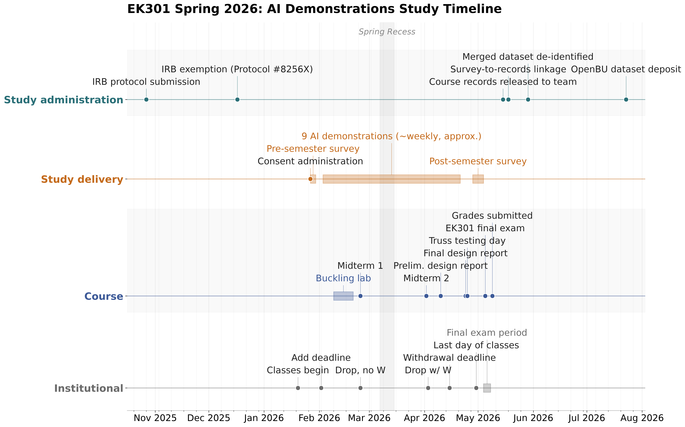

# EK301 Generative AI Study, Spring 2026

Data, analysis code, and figure-generation pipeline for *Structured AI Demonstrations and Student LLM Use in Engineering Mechanics: Study Design and Preliminary Results*.

## What this study did

EK301 (Engineering Mechanics I, statics) is a required core course taken by every College of Engineering major at Boston University. In Spring 2026 it ran across three lecture sections under a common syllabus, homework set, and truss design project. We surveyed students at the start and end of the semester about how they use generative AI tools, what they believe about those tools, and how they check AI output, then linked those responses to performance on the two common in-class midterms. One section, taught by the PI, additionally received nine short instructor-led AI demonstrations delivered at roughly weekly cadence during the last 5 to 15 minutes of class.

The study asks three questions: how students actually use LLMs in a problem-solving course, how that use relates to course performance, and whether brief recurring demonstrations shift either. 105 students consented to participate.

**The results are descriptive.** Sections were assigned by ordinary registration rather than randomization, the intervention ran in a single section, and the analysis carries no covariates for prior ability. Nothing here supports a causal claim about the demonstrations. The contribution is the reproducible study design, the survey instrument, the demonstration sequence, and a domain-specific empirical snapshot that other engineering educators can adapt and compare against.



*Study timeline. Four parallel tracks cover study administration (IRB, data linkage, de-identification), study delivery (consent, the pre- and post-semester surveys, the nine AI demonstrations), course events (buckling lab, midterms, truss project milestones, final exam), and institutional add, drop, and withdrawal deadlines. The shaded band is Spring Recess.*

## What is in this repository

The de-identified survey data, the loaders and figure code that regenerate every manuscript figure, the five qualitative codebooks, and the multi-model LLM coding pipeline used to code the free-text responses, including its full audit trail.

Study materials are covered by IRB Protocol #8256X (exempt, approved December 17, 2025). **We highly recommend contacting the PI elejeune@bu.edu if you are interested in secondary use of this data.**

---

## Table of contents

- [Repository layout](#repository-layout)
- [Project files](#project-files)
- [Setup](#setup)
- [The data](#the-data)
- [Reproduce the quantitative plots](#reproduce-the-quantitative-plots)
- [Reproduce the qualitative coding](#reproduce-the-qualitative-coding)
- [Reproduce the qualitative plots](#reproduce-the-qualitative-plots)
- [Reproduce the reliability tables](#reproduce-the-reliability-tables)
- [Figure map](#figure-map)
- [Files not tracked in this repository](#files-not-tracked-in-this-repository)
- [Citation and contact](#citation-and-contact)

---

## Repository layout

### Data (`data/`)

| File | Contents |
|---|---|
| `Spring_2026_quantitative.csv` | Ordinal and Likert responses, section assignment, grade quartile. 105 rows, 37 columns, keyed by `QuantID`. |
| `Spring_2026_qualitative.csv` | Free-text responses. 105 rows, 10 columns, keyed by `QualID`. |
| `Spring_2026_columnIDs.csv` | Data dictionary. 46 entries mapping each variable to its survey item, response options, and response type. |

**The two data files cannot be joined.** `QuantID` and `QualID` are independent randomized identifiers with deliberately disjoint ranges. This is a de-identification requirement, not an oversight. See [The data](#the-data).

### Loaders and metadata

| Module | Purpose |
|---|---|
| `load_research_data.py` | Loads and cleans the quantitative file; also provides the qualitative wide loader and the data dictionary loader. Defines `DATA_DIR`, `LIKERT_ORDER`, `FREQ_ORDER`, `GRADE_QUARTILE_ORDER`. |
| `load_qualitative.py` | Loads flat (multi-select) coded free-text exports plus their codebooks. |
| `load_qualitative_tiered.py` | Loads tiered (Tier 1 exactly-one plus Tier 2 select-all) coded exports. |
| `question_metadata.py` | Human-readable question text keyed by column name and by stem, derived at import from the data dictionary. Dependency-free. |

### Codebooks (`codebooks/`)

Five CSVs, one per coded item, in a uniform format: `Code ID`, `Tier`,
`Category`, `Code`, `Description`, `Do NOT apply when`, `Distinguish from`,
`Example responses`. `build_codebooks.py` compiles them into `codebooks.json`
together with the selection rules, exclusive codes, and tier cardinality defined
in its `RULES` dictionary. Appendix D of the manuscript is generated from these.

| File | Item |
|---|---|
| `codebook_txt_ai_demo_feedback_post.csv` | Demonstration feedback (flat) |
| `codebook_txt_ai_impact_describe_pre_post.csv` | Impact on learning (tiered) |
| `codebook_txt_ai_use_change_post.csv` | Change in AI use (flat) |
| `codebook_txt_ai_verify_correctness_pre_post.csv` | Verification behaviour (flat) |
| `codebook_txt_ai_workflow_steps_pre_post.csv` | Workflow steps (tiered) |

### Qualitative coding pipeline

Run in this order. Each stage writes files the next stage reads.

| Stage | Script | Reads | Writes |
|---|---|---|---|
| 1 | `build_codebooks.py` | `codebooks/*.csv` | `codebooks.json` |
| 2 | `run_llm_coding.py` | `data/Spring_2026_qualitative.csv`, `codebooks.json` | `results/<column>__<model>.jsonl` |
| 3 | `aggregate_results.py` | `results/*.jsonl` | `coded_long.csv`, `coded_binary.csv`, `reliability.csv`, `item_agreement.csv`, `review_queue.csv` |
| 4 | `adjudicate_llm.py` | `results/*.jsonl` | `final_codes.csv`, `final_long.csv` |
| 5 | `export_for_plots.py` | `results/final_codes.csv` | `qualitative_coding/*_coded.csv`, `*_qualitative_codebook.csv` |
| 6 | `report_stats.py` | `results/*.jsonl`, `final_codes.csv` | `report/*.csv`, `report/*.tex` |

### Plotting

| Module | Produces |
|---|---|
| `plot_style.py` | Central style configuration. Fonts, palettes, rcParams. Edit here to restyle every figure. |
| `plot_diverging_likert.py` | Diverging stacked Likert bars, pre/post rows per item. |
| `plot_stacked_freq.py` | Left-aligned stacked ordinal frequency bars, pre/post rows. |
| `plot_paired_histogram.py` | Paired pre/post histogram for the 0 to 10 rating item. |
| `plot_demo_experience.py` | 2x2 panel of the four demonstration-experience items. |
| `plot_grade_quartile_freq.py` | AI use frequency cross-tabulated by grade quartile. |
| `plot_demo_comparison.py` | Section-group comparisons of use frequency and quartile composition. |
| `plot_qualitative_codes.py` | Single-timepoint coded-theme bars for a flat item. |
| `plot_qualitative_pre_post.py` | Pre/post coded-theme bars for a flat item. |
| `plot_qualitative_tiered.py` | Tier 1 sentiment plus Tier 2 drivers, combined figures. |
| `manuscript_plots.py` | Driver script. Regenerates all thirteen figure PDFs. |
| `study_timeline.py` | The four-track study timeline figure. Standalone, reads no data. Creates `figures/` itself. |

---

## Project files

| File | Purpose |
|---|---|
| `pyproject.toml` | Project metadata and dependency floors. Sets `requires-python = ">=3.10"`. |
| `requirements.txt` | Exact version pins used to generate the published figures. |
| `.gitignore` | Excludes secrets, virtual environments, Python caches, and OS cruft. |
| `LICENSE` | MIT, covering the code only. The data carries separate terms. |

---

## Setup

**Python 3.10 or newer is required**, and 3.12 is what the figures were generated under.
This is a hard floor, not a preference: the modules use PEP 604 union annotations
(`str | None`), which are evaluated at function definition time and raise
`TypeError: unsupported operand type(s) for |` on 3.9 and earlier. If you hit that
error, you are running the wrong interpreter; check with `python --version`.

### Create an environment

```bash
uv venv edu --python 3.12
source edu/bin/activate          # Windows: edu\Scripts\activate
```

### Install packages

To reproduce the published figures exactly, install the pinned versions:

```bash
uv pip install -r requirements.txt
```

For an ordinary install against the dependency floors in `pyproject.toml`:

```bash
uv pip install -e .                 # figures and data analysis
uv pip install -e ".[coding]"       # adds the LLM coding pipeline SDKs


### API keys (coding pipeline only)

`run_llm_coding.py` and `adjudicate_llm.py` read keys from a `.env` file in the working
directory via `python-dotenv`. This file is not tracked.

```
OPENAI_API_KEY=...
GEMINI_API_KEY=...
CLAUDE_API_KEY=...
```

---

## The data

### Where the loaders look

`load_research_data.DATA_DIR` defaults to `data/`. Override it with the `EK301_DATA_DIR`
environment variable, or pass an explicit path to any loader. `data_path()` also falls
back to a flat layout and to a path relative to the module file, so the scripts work
from any working directory and with the deposited files unzipped into a single folder.

```python
from load_research_data import load_data, load_qualitative_wide, response_levels

data = load_data()                    # resolves data/Spring_2026_quantitative.csv
df   = data["all"]                    # 105 rows, cleaned; honesty-item rule applied
pre  = data["pre_likert"]
post = data["post_likert"]
pair = data["paired"]                 # 93 rows with both timepoints, integer-encoded

text = load_qualitative_wide()        # keyed by QualID, NOT joinable to df
```

### Response label capitalization

The deposit preserves capitalization exactly as Qualtrics recorded it. Items in survey
sections A and H store `Strongly agree`; sections C, D, and the demonstration Likert
item store `Strongly Agree`. This is intentional fidelity to the raw record, not an
error. Two consequences:

- `load_data()` normalizes both forms onto `LIKERT_ORDER` at load time, so downstream
  code sees one canonical set.
- If you work with the raw CSV directly, take level orderings per item from the
  `response_options` column of the data dictionary rather than assuming one shared
  scale. `response_levels("ai_use_freq_engmech_post")` returns them as an ordered list.

### Question labels

`question_metadata.py` derives all question text from the `survey_question_or_description`
column of the data dictionary at import time, stripping the shared Qualtrics
instruction stems. Nothing duplicates the wording, so editing the dictionary
updates every axis label and table. If a future instrument introduces a new
instruction stem, add it to `_INSTRUCTION_STEMS`; running the module directly
warns about any label that still contains a stray separator.

Because labels now come from the data, `question_metadata.py` raises
`FileNotFoundError` if the dictionary cannot be located.

### Missing values

Every survey item except the 0-10 impact rating required a response. A blank cell
therefore means either that the respondent did not take that survey, or, for the Section
C/D attitude items that offered it, that the respondent selected "Not Applicable". The
impact rating was optional: one respondent who took the early-semester survey left it
blank. After the honesty-item rule below, five of the 105 rows are post-only
respondents, seven are pre-only, and 93 have both. Per-item counts in the manuscript
figures reflect this.

### Honesty-item rule

`load_data()` applies one exclusion before anything else. Where `responded_honestly_post`
is Disagree or Strongly Disagree, every other post-survey column in that row is set to
missing; the row's pre-survey responses are kept. This applies to one respondent. The
honesty item asks whether the respondent answered *that* survey honestly and thoughtfully,
so it is applied per survey wave. The deposited CSV is unchanged; the rule is applied in
code from the public column, so no identifier is needed.

The rule is not applied to the qualitative file, because the two files cannot be linked
(this is required by the study's IRB protocol). That respondent's post-survey free text
therefore remains in the qualitative data. See Appendix F of the manuscript (data
processing log, step 7.4 and the note beneath the processing-steps table).

### CSV mechanics

All three files use CRLF line endings. The qualitative file contains real line breaks
inside quoted free-text fields, so it has more physical lines than records: 131 lines
for 105 responses. This is valid RFC 4180 and parses correctly. Do not use line-based
tools on it.

The four administrative rows of the data dictionary carry the literal string `N/A` in
`timepoint` and `item_number`. Read it with `keep_default_na=False`, as
`load_column_dictionary()` does, or those markers silently become missing values.

---

## Reproduce the quantitative plots

```bash
python manuscript_plots.py
```

Writes all thirteen figure PDFs to `figures/`. `DATA_PATH` resolves through
`load_research_data.data_path`, so no editing is needed if the data sits in `data/`.

Two companion scripts write the matched-sample figure and machine-readable counts:

```bash
python plot_paired_change.py     # figures/paired_change_matched.pdf + report/paired_*.csv
python export_figure_counts.py   # report/figure_counts/*.csv, the counts behind every figure
```

The timeline figure is separate:

```bash
python study_timeline.py
```

To regenerate one figure, import the plotting function directly:

```python
from load_research_data import data_path, QUANT_FILE
from plot_diverging_likert import plot_diverging_likert

plot_diverging_likert(
    data_path=str(data_path(QUANT_FILE)),
    col_stems=["understand_apply_principles", "understand_identify_mistakes"],
    title="Self-rated understanding of engineering mechanics",
    out_path="figures/understanding_eng_mech.pdf",
)
```

---

## Reproduce the qualitative coding

Each free-text response is coded independently by three LLMs from three providers, then
items with any disagreement or uncertainty flag go to a fourth adjudicating model that
judges strictly against the codebook rather than by majority vote.

```bash
python build_codebooks.py --codebook_dir codebooks --out codebooks.json

python run_llm_coding.py --data data/Spring_2026_qualitative.csv \
    --codebooks codebooks.json --outdir results

python aggregate_results.py --outdir results --codebooks codebooks.json

python adjudicate_llm.py --outdir results --codebooks codebooks.json

python export_for_plots.py --outdir results --codebooks codebooks.json \
    --plot_dir qualitative_coding
```

Useful flags:

- `run_llm_coding.py --limit 5` for a smoke test, `--models anthropic` to run one
  provider, `--columns txt_ai_use_change_post` to code one item.
- `aggregate_results.py --sample_n 20` draws a stratified sample per item for
  independent human coding.
- `adjudicate_llm.py --adjudicator_model <id>` changes the adjudicator.

**Resumability.** Results are cached to `results/<column>__<model>.jsonl` keyed by
`QualID`, and reruns skip completed items. Failed calls are retried automatically on
the next run without deleting the cache. Adjudication rulings are cached with a
fingerprint of the coder inputs they were based on, so adding a late third coding
invalidates only the affected items.

**Reproducibility caveat.** Sampling parameters are left at provider defaults because
current frontier models reject non-default values. Reproducibility comes from archiving
every raw output and pinning exact model IDs, not from greedy decoding. Re-running from
a wiped cache will not reproduce the published codes exactly.

**Validity caveat.** Inter-model agreement establishes reliability, not validity. There
is no human-coded validation sample. Every response retains a full audit trail: each
coder's codes and rationales, the adjudicator's ruling, and uncertainty flags.

---

## Reproduce the qualitative plots

The qualitative figures read the exports in `qualitative_coding/`, so run
`export_for_plots.py` first. Then:

```bash
python manuscript_plots.py
```

`manuscript_plots.py` generates both quantitative and qualitative figures in one pass.
`QUAL_DIR` at the top of that file points at the directory containing
`qualitative_coding/`; it defaults to the repository root.

---

## Reproduce the reliability tables

```bash
python report_stats.py --outdir results --codebooks codebooks.json --report_dir report
```

Writes `reliability_summary.csv` and `reliability_by_code.csv`, the two LaTeX tables
that appear in Appendix E, and a drafted methods paragraph with all numbers filled in.
The `--min_prev` flag (default 0.05) sets the prevalence floor below which Fleiss'
kappa is suppressed as unstable.

---

## Figure map

| Manuscript | Output PDF | Produced by |
|---|---|---|
| Figure 1 | `ek301_study_timeline.pdf` | `study_timeline.py` |
| Figure 2 | `ai_attitude_pre_post.pdf` | `fig_ai_attitudes()` |
| Figure 3 | `txt_ai_workflow_steps_pre_post.pdf` | `fig_workflow_steps_qual()` |
| Figure 4 | `txt_ai_impact_describe_pre_post.pdf` | `fig_impact_describe_qual()` |
| Figure 5 | `ai_use_freq_pre_post.pdf` + `txt_ai_use_change_post.pdf` | `fig_ai_frequency()`, `fig_use_change_qual()` |
| Figure 6 | `txt_ai_verify_correctness_pre_post.pdf` | `fig_verify_correctness_qual()` |
| Figure 7 | `understanding_eng_mech.pdf` | `fig_understanding()` |
| Figure 8 | `ai_use_freq_with_grades.pdf` | `fig_grade_quartile()` |
| Figure 9 | `ai_demo_experience.pdf` + `txt_ai_demo_feedback_post.pdf` | `fig_demo_experience()`, `fig_demo_feedback_qual()` |
| Figure 10 | `ai_use_freq_by_demo_section.pdf` + `grade_quartile_by_demo_section.pdf` | `fig_use_freq_by_demo()`, `fig_grade_by_demo()` |

Figures 5, 9, and 10 each combine two script outputs into one manuscript float.

---

## Files not tracked in this repository

`.gitignore` excludes only four things: the `.env` file holding API keys, virtual
environments (`edu/`, `.venv/`, `venv/`, `env/`), Python build and cache artifacts, and
OS or editor cruft.

**Everything the pipeline generates is committed on purpose.** `codebooks.json`,
`results/`, `qualitative_coding/`, `report/`, and `figures/` are all tracked, so a
reader can inspect the coded output, the reliability tables, and the figures without
installing anything or holding API keys. Committing `results/` in particular is what
preserves the audit trail the manuscript describes: each coder's codes and rationales,
the adjudicator's ruling, and uncertainty flags. It also keeps the coding stage
resumable for anyone who clones the repository, since re-running the APIs will not
reproduce the published codes exactly.

The trade-off is churn: regenerating figures produces binary diffs on every run. If
that becomes a nuisance, `figures/` is the one directory safe to ignore, since it is
fully derived from committed inputs.

---

## Citation and contact

Cite the manuscript and the OpenBU deposit separately. The deposit DOI and the
manuscript reference will be included once both are final.

The code in this repository is MIT licensed. The data is not: it is governed by the
terms recorded with the OpenBU deposit, by IRB Protocol #8256X, and by FERPA. See
`LICENSE`.

The published dataset is a reduced version of the study's working data. Qualitative and
quantitative records are unlinkable, free text has been redacted, and performance is
reported only as broad quartiles. Considerable context that is necessary for correct
interpretation could not be published without compromising de-identification.
**Secondary researchers should contact the study authors before attempting data reuse.**
